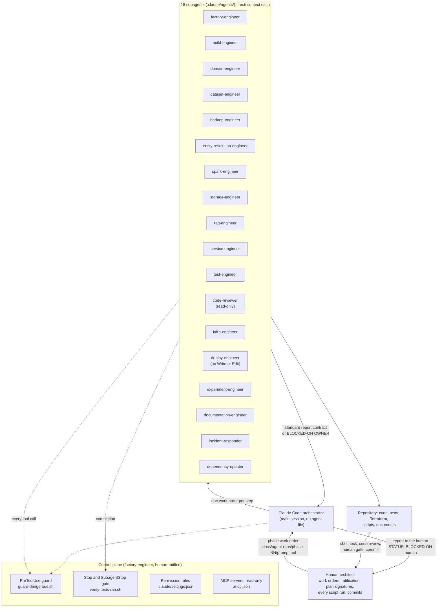
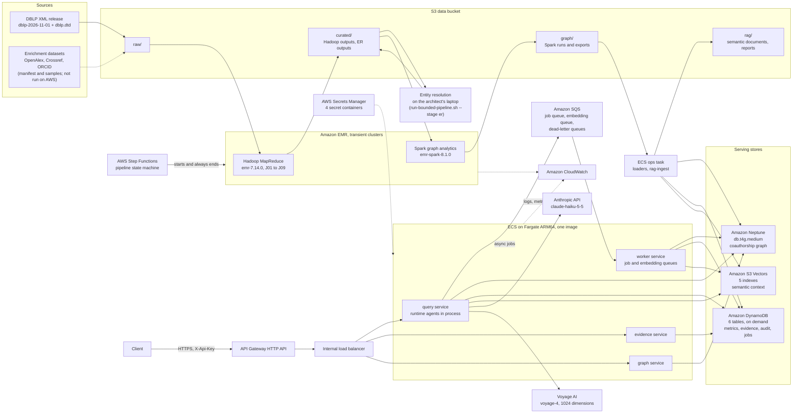
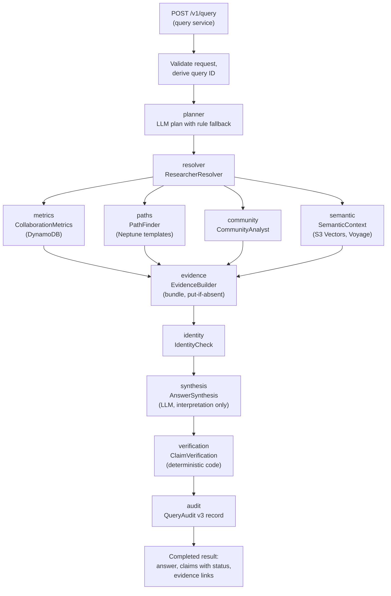

# ScholarChain architecture

ScholarChain builds an evidence-bearing, temporal, weighted coauthorship graph from the DBLP XML release and answers collaboration-breadth, connectivity and bridge questions with machine-readable evidence. This document describes two related systems: the **build-time workflow** (how the repository was built by a human architect and Claude Code agents) and the **runtime architecture** (the data pipeline and the query services as deployed on AWS in Phases 14 and 15).

**State at Phase 17:** the AWS environment no longer exists. `scripts/cleanup.sh` removed 175 Terraform resources on Nov 21 under the instructor-approved teardown (Phase 15 gate, [`docs/agent-runs/phase-15/human-gate.md`](agent-runs/phase-15/human-gate.md)). Everything below the build-time section describes the system as it was built and run, with the records that show it. The documented final state is in [`docs/final-state.md`](final-state.md) (Phase 17 step W2).

Related documents: [`docs/data-lineage.md`](data-lineage.md) (what each stage reads and writes), [`docs/api.md`](api.md) (the REST routes), [`docs/agents.md`](agents.md) (agent ownership, owned by factory-engineer), [`docs/evaluation.md`](evaluation.md) (measured results).

Contents:

- [1. Build-time workflow](#1-build-time-workflow)
- [2. Runtime architecture](#2-runtime-architecture)
- [3. The runtime query workflow](#3-the-runtime-query-workflow)
- [4. Why each technology is used](#4-why-each-technology-is-used)
- [5. Consolidation of services](#5-consolidation-of-services)
- [6. What was not built](#6-what-was-not-built)
- [7. Design notes](#7-design-notes)

## 1. Build-time workflow

*Caption: hub and spoke. The human gives each phase a work order; the orchestrator routes each step to the one owning subagent; subagents never call each other; hooks and permission rules check every tool call; the human ratifies, signs, runs the scripts and commits.*

**How it works** (from `CLAUDE.md` and [`docs/agents.md`](agents.md)):

- **Human architect.** Writes each phase's work order under `docs/agent-runs/phase-NN/prompt.md`, ratifies constitutional changes, signs Terraform plans (`APPROVED-PLAN-SHA256:` lines in the phase's `approvals.md` or `human-gate.md`), labels the entity-resolution gold set, runs every deployment, pipeline, experiment and cleanup script from Phase 14 on, and writes each phase's `human-gate.md` and commit.
- **Orchestrator.** The main Claude Code session. It interprets the work order, invokes the owning subagent, reads its report, routes `BLOCKED-ON` work, and does no specialist work itself.
- **18 subagents.** One file each under `.claude/agents/`, one owner per artifact path ([`docs/agents.md`](agents.md), "Artifact ownership"). The reviewer has no write tools; deploy-engineer has no Write or Edit and runs only approved scripts; infra-engineer may plan but never apply.
- **Hooks.** `.claude/hooks/guard-dangerous.sh` (PreToolUse) blocks destructive commands, Terraform apply and destroy, secret reads, writes outside an agent's territory and watchers; `.claude/hooks/verify-tests-ran.sh` (Stop and SubagentStop) refuses completion after a source change unless fresh, passing sbt test reports or the `sbt check` marker exist; `.claude/hooks/format-scala.sh` formats Scala after writes; `.claude/hooks/validate-agent-files.sh` validates the agent system.
- **Gates.** Each phase ends with targeted tests, a full `sbt check` by the wave closer, code-reviewer (and test-engineer where the phase needs it), and the human gate. Phase records live in `docs/agent-runs/phase-00/` to `docs/agent-runs/phase-17/` plus `amendment-01/` and `amendment-02/`.
- **MCP servers** (`.mcp.json`): `aws-api` (read-only), `aws-docs`, `terraform` (registry documentation) and `github`, which is defined but switched off ([`docs/agents.md`](agents.md), "MCP servers and trust boundaries").

## 2. Runtime architecture

*Caption: the deployed runtime (Phases 14 and 15). Hadoop and Spark ran on transient EMR clusters started by Step Functions; entity resolution ran locally between them; an ECS ops task loaded Neptune, DynamoDB and S3 Vectors; four ECS services served the API behind API Gateway and an internal load balancer. Removed on Nov 21.*

The pieces, with the record that shows each one:

| Piece | As built | Record |
|---|---|---|
| S3 data lake | one bucket, prefixes `raw/`, `curated/`, `graph/`, `rag/`, `artifacts/`, `logs/`, `reports/`; versioning, encryption, public access blocked | Phase 12 gate, area 4 ([`docs/agent-runs/phase-12/human-gate.md`](agent-runs/phase-12/human-gate.md)) |
| EMR | no cluster in Terraform; the state machine starts one per stage; Hadoop on `emr-7.14.0`, Spark on `emr-spark-8.1.0`; On-Demand only; 2 to 4 core nodes by managed scaling; ends after 15 idle minutes | Phase 12 gate, area 5 |
| Entity resolution | runs on the architect's laptop between the Hadoop and Spark stages | [`docs/agent-runs/phase-13/prompt.md`](agent-runs/phase-13/prompt.md), decision 12, deviation 2; Phase 14 gate ([`docs/agent-runs/phase-14/human-gate.md`](agent-runs/phase-14/human-gate.md)), "Pipeline" |
| Neptune | one `db.t4g.medium` instance, private, encrypted, IAM authentication; engine 1.4.7.1 | Phase 12 gate, area 7 and "Checked by me" |
| DynamoDB | six tables (RunLedger, EntityLinkCache, QuerySession, EvidenceBundle, ArtifactRegistry, ResearcherMetricCache), on demand | Phase 12 gate, area 6; `modules/storage/src/main/scala/org/scholarchain/storage/dynamo/TableSpecs.scala` |
| S3 Vectors | one vector bucket, five indexes (`researcher-profile-v1`, `collaboration-community-v1`, `paper-abstract-v1`, `collaboration-path-v1`, `topic-institution-summary-v1`) | Phase 12 gate, area 8; `config/course.json:48-59` |
| ECS on Fargate | one image, four services (`query`, `evidence`, `graph`, `worker`) plus an `ops` task definition; ARM64 | Phase 12 gate, area 10 |
| API Gateway | HTTP API with HTTPS in front of an internal load balancer; throttle rate 5 requests/s, burst 10 | Phase 12 gate, area 10; [`docs/agent-runs/phase-12/agent-report-infra-2b.md`](agent-runs/phase-12/agent-report-infra-2b.md), "Ingress" |
| Step Functions | one state machine that runs the EMR pipeline and always ends the cluster | Phase 12 gate, area 11 |
| SQS | job queue and embedding queue, each with a dead-letter queue | Phase 12 gate, area 11 |
| CloudWatch | log groups, a dashboard, alarms, an alarm topic; AWS's default metrics | Phase 12 gate, area 12 |
| Secrets Manager and encryption | four secret containers (values set by hand in the console, Phase 14); AWS-managed encryption keys | Phase 12 gate, area 3; Phase 14 gate, "Only approved, committed scripts" |
| Model providers | Anthropic API (`claude-haiku-5-5`) and Voyage AI (`voyage-4`, 1024 dimensions) instead of Amazon Bedrock; the Bedrock switch is kept | `config/course.json:15-18`, `:60-81`; [`docs/agent-runs/instructor-approvals.md`](agent-runs/instructor-approvals.md) |

The whole environment was defined in Terraform under `infra/terraform/` (modules `foundation`, `network`, `identity`, `data-lake`, `emr`, `dynamodb`, `neptune`, `vectors`, `runtime`, `workflow`, `observability`) and changed only through signed plans and `scripts/deploy.sh`. Terraform is frozen in Phase 17 (work order decision 2).

## 3. The runtime query workflow

*Caption: the runtime agents, in the order `QueryWorkflow` runs them (`modules/rag/src/main/scala/org/scholarchain/rag/runtime/QueryWorkflow.scala:172-240`, stage names at `:828-840`). They run inside one process (the `query` service, or the `worker` for async jobs), not as separate services.*

Deterministic graph facts (counts, paths, components, communities, bridge measures) come from Spark outputs stored in DynamoDB and Neptune. The model writes interpretation only; every claim is checked by `ClaimVerification`, deterministic code, against the evidence bundle, and only `verified` and `partially_supported` claims stay in the answer ([`docs/api.md`](api.md#9-claim-verification-statuses-and-reasons)).

## 4. Why each technology is used

Each reason below is the argument recorded in a phase gate, work order or report, not a product description.

- **S3 raw and curated zones.** The pipeline stages never call each other in code; they exchange versioned files whose schemas are defined in `core` (`CLAUDE.md`, "Module dependency boundaries"). S3 keys are versioned and files are never overwritten, with content hashes and source references (Phase 7 gate, [`docs/agent-runs/phase-07/human-gate.md`](agent-runs/phase-07/human-gate.md)), so every stage's input is a fixed, addressable run.
- **Hadoop MapReduce on EMR.** The parse, normalize, mention, blocking and pair-candidate work is record-at-a-time and shuffle-shaped. The Phase 4 gate ([`docs/agent-runs/phase-04/human-gate.md`](agent-runs/phase-04/human-gate.md)) records why the jobs are real MapReduce: a DBLP reader that reads every record exactly once across file splits, coauthor pairs correct for any team size, counters where input equals accepted plus excluded plus rejected, and identical output on rerun. Phases 14 and 15 reproduced the same counters on EMR at two build commits ([`experiments/results-summary.md`](../experiments/results-summary.md), section 2.6). The contract of each job (types, input and output locations, classes, codec, configuration keys, tests and fixtures) is in [`docs/hadoop-job-contracts.md`](hadoop-job-contracts.md). Two items recorded there as known limitations at step E12 were handled in Phase 17 repair round R3. Blocking oversize groups (finding B1, check HADOOP-04): counting pre-passes now list oversize keys before J05 and J05b, so an oversize group no longer reaches one reduce call; the reducer-side cap remains only as a guard ([section 13.1](hadoop-job-contracts.md#131-j05-oversize-blocks-the-cap-is-enforced-before-the-reduce-step-check-hadoop-04-fixed)). This is fixed in code, tested locally, not validated live on AWS; the recorded experiment results were produced by the earlier code. Teams over the hard limit are still rejected and counted (finding B3, check HADOOP-PAIRS-WRONG): a deliberate safety bound, kept with no code change ([section 13.2](hadoop-job-contracts.md#132-teams-over-the-hard-limit-are-rejected-check-hadoop-pairs-wrong)).
- **Entity resolution on the laptop.** `ErMain` reads and writes local files only, the bounded data is small, and running it locally avoids EMR cost ([`docs/agent-runs/phase-13/prompt.md`](agent-runs/phase-13/prompt.md), decision 12, deviation 2). The laptop run in Phase 14 matched Phase 5's accepted run exactly (Phase 14 gate, "Pipeline").
- **Spark on EMR.** Graph construction and analytics (distinct coauthors, weighted degree, team sizes, components, communities, k-core, bridge measures, path evidence) need joins and iterative algorithms over the whole graph. Spark consumes the Hadoop outputs instead of re-parsing DBLP, never collects the whole graph to the driver (every driver-side `.collect()` and its bound: [section 7.2](#72-spark-collect-calls-and-their-bounds)), and is checked on hand-checkable known graphs (Phase 6 gate, [`docs/agent-runs/phase-06/human-gate.md`](agent-runs/phase-06/human-gate.md)). `sparkAnalytics` compiles with Scala 2.13 to match the EMR Spark runtime, an instructor-approved deviation (`CLAUDE.md`, "Scala versions").
- **Neptune.** Paths and neighbourhoods are graph traversals. The runtime reaches Neptune only through typed, parameterized query templates with validated integers and window labels, so user text never becomes database code (Phase 9 gate, [`docs/agent-runs/phase-09/human-gate.md`](agent-runs/phase-09/human-gate.md)). One `db.t4g.medium` instance was chosen because it is the free-trial class (Phase 12 gate, area 7).
- **DynamoDB.** Per-window metrics, rankings, evidence bundles, the entity-link cache, the run ledger and audit records, and query jobs are key lookups and conditional writes. Per-window metrics live in DynamoDB, full-window metrics also on Neptune nodes; safe repeat writes rely on conditional puts (Phase 7 gate). Tables are on demand with point-in-time recovery off because the data can be rebuilt (Phase 12 gate, area 6).
- **S3 Vectors.** The durable semantic tier for researcher, community, paper, path and topic summaries. Vector metadata stays small and long text stays in S3; vector similarity never supplies a count, edge or path (Phase 7 gate; `CLAUDE.md`, "Architecture invariants"). In the Phase 15 retrieval-mode experiment, vector-only retrieval scored MRR 0.003 against 0.818 graph-only (exploratory, n = 11; Phase 15 gate, Results), which is consistent with using vectors for context, not for graph facts (interpretation; `docs/evaluation.md` states the limits of that experiment).
- **Anthropic and Voyage instead of Bedrock.** Every Amazon Bedrock quota of the project's account was 0. The instructor approved the Anthropic API for synthesis and Voyage AI for embeddings, with the rest on AWS and the Bedrock switch kept ([`docs/agent-runs/instructor-approvals.md`](agent-runs/instructor-approvals.md)).
- **ECS on Fargate, ARM64.** The four services run from one container image and each scales on its own (section 5); ARM64 matches the image built on the architect's arm64 laptop (Phase 12 gate, "Items earlier gates sent to Phase 12", Phase 2 row; [`docs/agent-runs/phase-13/prompt.md`](agent-runs/phase-13/prompt.md) records the laptop as arm64 macOS).
- **API Gateway in front of an internal load balancer.** HTTPS at the edge, no public load balancer, and a request throttle sized for one person's smoke tests and demo (rate 5/s, burst 10; [`docs/agent-runs/phase-12/agent-report-infra-2b.md`](agent-runs/phase-12/agent-report-infra-2b.md), "Ingress"). The throttle dominated the Phase 15 read-load experiment above one client (Phase 15 gate, Results).
- **Step Functions.** Runs the EMR pipeline and always ends the cluster, including on failure (Phase 12 gate, area 11 and "Step Functions or SQS only": both).
- **SQS.** Carries the async query jobs and the embedding (re-embed) work, each queue with a dead-letter queue; at-least-once delivery with a job lease and a visibility timeout longer than the lease (Phase 12 gate, area 11; [`docs/agent-runs/phase-12/agent-report-infra-2b.md`](agent-runs/phase-12/agent-report-infra-2b.md)). Phase 15 experiment C showed the worker scaling 0 → 1 → 2 → 0 on the queue (Phase 15 gate).
- **CloudWatch.** Replaced the planned `/metrics` endpoint: log groups, a dashboard and alarms over AWS's default metrics for EMR, ECS, SQS, Neptune, DynamoDB and the API (Phase 12 gate, area 12 and the Phase 10 `/metrics` row).
- **Secrets Manager and AWS-managed keys.** Secret values never sit in code or configuration; configuration holds only environment-variable names (`config/course.json`). Encryption uses AWS-managed keys, no customer-managed KMS key, for cost (Phase 12 gate, area 3; [`docs/agent-runs/phase-12/prompt.md`](agent-runs/phase-12/prompt.md), decision 6, item 3).
- **Terraform and approved scripts.** Every AWS resource is in Terraform under `infra/terraform/`; apply runs only from a human-signed plan through `scripts/deploy.sh` (`CLAUDE.md`, "Security invariants").

## 5. Consolidation of services

The course specification lists per-stage runtime services (query, graph retrieval, vector retrieval, ranking, answer synthesis, verification, workers). The Phase 12 work order allowed "a justified consolidation that preserves independent scaling where needed" and the built system is:

- **One image, four ECS services**, one per `Main --role`: `query`, `evidence` and `graph` behind the load balancer, and `worker` driven by SQS, plus an `ops` task definition for the loaders (Phase 12 gate, area 10).
- **Vector retrieval, ranking, synthesis and verification run inside `query`**, as stages of one in-process workflow (the Phase 10 service design); the `worker` runs the same workflow for async jobs.
- **Each of the four services scales on its own** (CPU target tracking for `query`, `evidence` and `graph`; queue-driven step scaling from 0 for `worker`; [`docs/agent-runs/phase-12/agent-report-infra-2b.md`](agent-runs/phase-12/agent-report-infra-2b.md), "Autoscaling").
- **No service discovery**: the services never call each other, only the shared stores and queues (Phase 12 gate, area 10).
- Role `all` (everything in one process) is used only for local runs and tests, never on AWS.

Reason recorded in the Phase 12 work order ([`docs/agent-runs/phase-12/prompt.md`](agent-runs/phase-12/prompt.md), decision 6, item 10): the specification's baseline needs at least three independently deployable runtime services, and each scales on its own; query, retrieval, ranking, synthesis and verification running inside the query role's workflow is recorded there as a justified consolidation of the specification's per-stage services.

## 6. What was not built

| Item | Status | Record |
|---|---|---|
| OpenSearch (optional tier) | not built: no hybrid, faceted or hot-tier retrieval was implemented | Phase 12 gate, area 9; Phase 7 gate |
| GitHub Actions | not built: no `.github/workflows/` folder exists | repository tree |
| GitHub MCP server | defined in `.mcp.json` but switched off (no token) | [`docs/agents.md`](agents.md), "MCP servers and trust boundaries" |
| OpenAPI file | not generated; the route reference is [`docs/api.md`](api.md) | `docs/api.md` |
| Amazon Bedrock | not used (quota 0); the Bedrock switch is kept in code | [`docs/agent-runs/instructor-approvals.md`](agent-runs/instructor-approvals.md); Phase 15 gate (`RequiresAws` row: both Bedrock tests fail on quota 0) |
| Enrichment on AWS | the Phase 14 and 15 EMR runs read DBLP only; J02 (source normalization) did not run there | [`docs/data-lineage.md`](data-lineage.md#2-sources) |
| Custom CloudWatch metrics (LLM usage, S3 Vectors calls) | not built | Phase 12 gate, area 12; Phase 16 gate ([`docs/agent-runs/phase-16/human-gate.md`](agent-runs/phase-16/human-gate.md)), "custom metrics" row |
| Glue catalog, EventBridge rules | not built (not used; the EMR steps poll) | Phase 12 gate, areas 4 and 11 |
| EMR Spot capacity | not used (On-Demand only: failure handling untested) | Phase 12 gate, area 5 |
| Customer-managed KMS keys | not used (AWS-managed keys) | Phase 12 gate, area 3 |
| Remote Terraform state | not built; local state with the remote design in `infra/terraform/STATE.md` | Phase 12 gate, area 1 |
| Graph neighbourhoods deeper than 1; `HAS_TOPIC`, `AFFILIATED_WITH`, `PUBLISHED_IN` neighbour queries | not served (422) | [`docs/api.md`](api.md#58-get-v1graphnodesnodeidneighbors); Phase 7 gate (no topic or affiliation data) |
| Venue and institution filters | refused with 422 (no venue metrics or institution data) | [`docs/api.md`](api.md#53-post-v1query) |
| Betweenness centrality | not computed; bridge measures are participation coefficient, cross-community degree and communities connected | Phase 6 gate |
| Terraform environment-parity guard (K-01) | not built (Terraform frozen in Phase 17) | Phase 16 gate; Phase 17 work order decision 2 |
| A live system | removed Nov 21 (instructor-approved teardown) | Phase 15 gate |

## 7. Design notes

Written in Phase 17 session 3, step E12, in answer to two autograder warnings (V01 and A01). Both notes describe existing code at commit `d8b49fa`. No code was changed.

### 7.1 Fixed model IDs in code

The autograder flagged two lines as hard-coded model IDs. Neither selects the model the system uses; both belong to the Bedrock switch, which is kept but not used (every Bedrock quota of the account was 0; [`docs/agent-runs/instructor-approvals.md`](agent-runs/instructor-approvals.md), line 12).

- **The models in use come from configuration.** They are `models.embeddingModelId` `voyage-4` and `models.answerModelId` `claude-haiku-5-5` (`config/course.json:15-18`). The providers are `embedding.provider` `voyage` and `llm.provider` `anthropic` (`config/course.json:61`, `:72`). The release manifest records the same values ([`release-manifest.md`](../releases/manifest/b4d8f1229fc145e1492e1a8cbb8a44a368d026af/release-manifest.md), section "Models (config/course.json)", lines 139-147). The code reads the embedding model from configuration (`modules/rag/src/main/scala/org/scholarchain/rag/embedding/EmbeddingModelSpec.scala:110-118`).
- **`EmbeddingModelSpec.scala:55`** (`BedrockTitanModel = "amazon.titan-embed-text-v2:0"`) is an allow-list, not a default. The Bedrock embedding switch accepts only that model and refuses any other ID (`EmbeddingModelSpec.scala:89-97`). The reason is that the code's dimension set (`:60`) and input limit (8,192 tokens, `:62-69`) are Titan Text Embeddings V2's. A different Bedrock model ID from configuration would select a model whose dimensions and limits the code does not know. The Phase 7 work order chose this model for the switch ([`docs/agent-runs/phase-07/prompt.md`](agent-runs/phase-07/prompt.md), line 170).
- **`Llm.scala:638`** is the Bedrock namespace prefix `anthropic.`, not a model ID. `bedrockModelId` adds it to `models.answerModelId` from configuration when it is missing (`modules/rag/src/main/scala/org/scholarchain/rag/runtime/Llm.scala:636-638`). The Phase 9 work order records the synthesis model as a fixed ID with Bedrock ID `anthropic.claude-haiku-5-5` ([`docs/agent-runs/phase-09/prompt.md`](agent-runs/phase-09/prompt.md), lines 144 and 235). The instructor approval records how both switches are applied ([`docs/agent-runs/instructor-approvals.md`](agent-runs/instructor-approvals.md), line 34).
- **Why exact, pinned IDs.** The embedding model ID is part of the model spec stored in every vector's metadata. Changing any field of it changes the ID, and the ingest pipeline then re-embeds every key (`EmbeddingModelSpec.scala:15-23`). An exact, pinned ID therefore keeps stored vectors and answers traceable to the model that made them. A moving alias would change vectors without changing the recorded ID.

### 7.2 Spark collect calls and their bounds

There are 18 Spark `.collect()` calls in `modules/spark/src/main` (a read-only check by code-reviewer at `d8b49fa`; the autograder's count is also 18). Each brings a result to the driver.

- 17 are bounded by a number that does not grow with the input. 11 are bounded by a literal limit or a configuration value with an upper validation cap. 6 are bounded only by configuration values that have no upper validation cap.
- 1, `sizeBuckets`, grows with the input. It is listed as a known limitation below.

Paths below are under `modules/spark/src/main/scala/org/scholarchain/spark/`. The validation caps are in `JobConfig.scala`:

- `pathTopK` is 0..100 (`:122`);
- `pathRandomPairs` is 0..100 (`:123`);
- `diameterSources` is 0..100 (`:124`).

`pathMaxDepth` (`:121`) and `diameterMaxDepth` (`:125`) are checked only as at least 1. The number of windows is checked only as non-empty with distinct labels (`:100-101`). The committed job configuration [`modules/spark/conf/phase06.json`](../modules/spark/conf/phase06.json) sets:

- `pathMaxDepth` 6 (line 22);
- `diameterMaxDepth` 12 (line 26);
- five windows (lines 7-13).

These are the values the bounds marked "committed config" use. The path pairs number at most C(100,2) + 100 = 5,050 (top-K pairs plus random pairs, `Paths.scala:103-109`), with at most 400 distinct researcher IDs (`Paths.scala:111`).

| # | Call (file:line) | What reaches the driver | Bound |
|---|---|---|---|
| 1 | `JsonlExport.scala:537` | up to 5 decode-error strings | `.limit(5)` at `:537` |
| 2 | `Output.scala:157` | up to 5 validation-error strings | `.limit(5)` at `:157` |
| 3 | `Output.scala:158` | up to 20 records of one table (round-trip sample) | `.limit(20)` at `:158` (row count fixed; a record's width depends on its array fields) |
| 4 | `Paths.scala:60` | seeded researcher IDs | `.limit(n)` at `:59`, n ≤ 200 or ≤ 100 (`Paths.scala:100-101`; `JobConfig.scala:123-124`) |
| 5 | `Paths.scala:85` | top-K researcher IDs | `.limit(cfg.pathTopK)` at `:83`, ≤ 100 (`JobConfig.scala:122`) |
| 6 | `Paths.scala:93` | the largest component | `.limit(1)` at `:92` |
| 7 | `Paths.scala:118` | vertex index of the wanted IDs | `isin(wanted)` at `:116`, ≤ 400 IDs (`:111`) |
| 8 | `Paths.scala:126` | component of the wanted IDs | `isin(wanted)` at `:124`, ≤ 400 IDs |
| 9 | `Paths.scala:211` | BFS parent chains | **config only:** ≤ pairs × (`pathMaxDepth` + 1) rows (comment `:208`; loop cap `:193`; one parent per node, `Algorithms.scala:276-278`); committed config: ≤ 5,050 × 7 = 35,350 rows |
| 10 | `Paths.scala:220` | researcher IDs of the chain nodes | **config only:** `isin(nodeIdx)` at `:218`, the distinct nodes of #9 (`:213`) |
| 11 | `Paths.scala:265` | one edge row per path hop | **config only:** join with the hop keys (`:251-257`), ≤ 5,050 × `pathMaxDepth` rows; a row's `supportingWorkIds` grows with the pair's joint papers |
| 12 | `Paths.scala:306` | distance histogram for the effective diameter | **config only:** `groupBy("dist")` at `:303`, dist ≤ `diameterMaxDepth` (`Algorithms.scala:270`); committed config: ≤ 12 rows |
| 13 | `Pipeline.scala:900` | display names of researchers on evidence paths | **config only:** `isin(pathIds)` at `:898`, the path IDs of #9 (`:892`) |
| 14 | `Pipeline.scala:948` | integrity-violation counts per check and window | **config only:** `groupBy("check", "windowLabel")` at `:945`. The checks are 11 literal checks with an empty window label (`GraphBuild.scala:93-94`, `:341-353`) plus 2 per window (`Pipeline.scala:645`, `:654`), so there are ≤ 11 + 2 × windows rows; committed config: ≤ 21 rows |
| 15 | `Pipeline.scala:1116` | (size, count) for every distinct component or community size | **grows with the input** (known limitation below) |
| 16 | `Pipeline.scala:1133` | the largest component | `.limit(1)` at `:1133` |
| 17 | `Pipeline.scala:1136` | the largest community | `.limit(1)` at `:1136` |
| 18 | `Pipeline.scala:1142` | the top 15 coreness values | `.limit(15)` at `:1141` |

**Stated plainly.** Rows 9 to 14 are bounded only because the configured `pathMaxDepth`, `diameterMaxDepth` and window count are small. The code does not cap them from above. A configuration with a very large depth or many windows would bring proportionally more rows to the driver. The committed configuration's bounds are the ones given in the table.

**Known limitation: `sizeBuckets` (`Pipeline.scala:1111-1122`).**

- **What it does.** `sizeBuckets` groups by the data-valued `size` (`:1114`) and collects one row per distinct size (`:1116`). It applies its 9 fixed buckets (`:1099-1109`) on the driver after the collect (`:1118-1121`). It is called for components and for communities (`:1158`, `:1162`).
- **How large the result can get.** The distinct sizes of k groups sum to at most N researchers, so k(k+1)/2 ≤ N and the result has fewer than √(2N) rows. That is about 2,650 rows of two numbers at N = 3.5 million (an illustrative size, not a measured one). At the measured full-window size of 200,484 researchers ([final report, section 9](../reports/final-report.md#9-spark-coauthorship-graph-collaboration-metrics-paths-communities-bridge-analysis-and-temporal-analytics)) it is at most 632 rows.
- **The limitation.** The result is small, but it grows with the input. Bucketing on the executors before the `groupBy` would cap it at 9 rows.
- **Status.** That change belongs to spark-engineer and is out of scope after the release candidate. It is listed in [final report section 23.1](../reports/final-report.md#231-system-and-scope-limitations).
