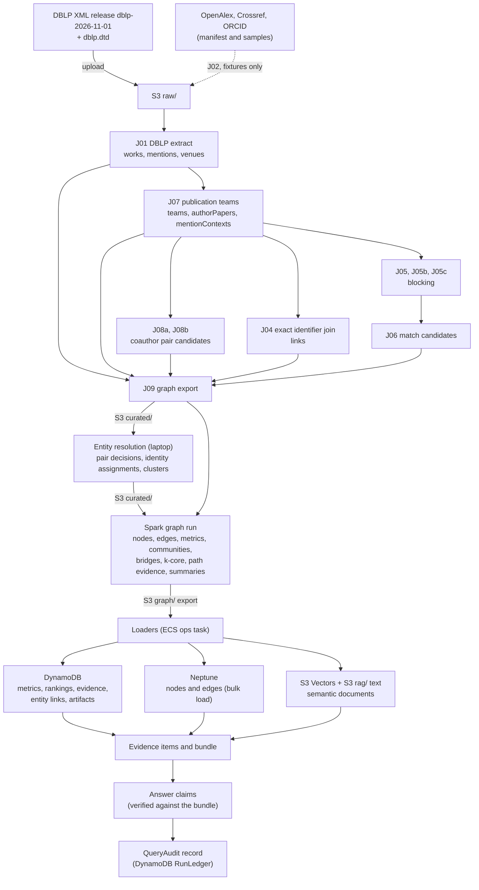

# ScholarChain data lineage

This document traces one fact from the source dataset to an answer: DBLP and the enrichment datasets → Hadoop jobs J01 to J09 → entity resolution → Spark tables → loaders → Neptune, DynamoDB, ordinary S3 and S3 Vectors → evidence items → answer claims → the audit record. For each stage it names the inputs, outputs, schema versions, run IDs, partitioning and provenance fields, and the counts the Phase 14 and Phase 15 records hold. Every count names its source.

Bucket names, account details and hosts never appear here; the data bucket is written `{data-bucket}`.

Contents:

- [1. Overview](#1-overview)
- [2. Sources](#2-sources)
- [3. Hadoop jobs J01 to J09](#3-hadoop-jobs-j01-to-j09)
- [4. Entity resolution](#4-entity-resolution)
- [5. Spark graph construction and analytics](#5-spark-graph-construction-and-analytics)
- [6. Loaders and stores](#6-loaders-and-stores)
- [7. Evidence, answer claims and the audit record](#7-evidence-answer-claims-and-the-audit-record)
- [8. Provenance fields and schema versions](#8-provenance-fields-and-schema-versions)
- [9. Run IDs of the recorded runs](#9-run-ids-of-the-recorded-runs)

## 1. Overview

*Caption: the chain of stages. Each arrow is a versioned file set or a store write addressed by a run ID; no stage calls another stage's code.*

The stages exchange data only through versioned files whose schemas are defined in `modules/core` (`CLAUDE.md`, "Module dependency boundaries"). Each stage writes a new folder named by its run ID, so a rerun never overwrites an earlier run.

## 2. Sources

Every dataset is listed in `datasets/dataset-manifest.yaml` with its license, snapshot and checksums.

| Dataset | Role | Snapshot | Used in the AWS runs | Source |
|---|---|---|---|---|
| DBLP XML | primary | `2026-11-01` (file `dblp-2026-11-01.xml.gz`, 1,116,142,729 bytes, sha256 `0376ad01…1b18`; `dblp.dtd` 13,134 bytes, sha256 `2d864498…1ef6`) | yes (Phases 14 and 15) | `datasets/dataset-manifest.yaml:354-442`; [`docs/agent-runs/phase-14/runbook-log.md`](agent-runs/phase-14/runbook-log.md), rows D5a to D5c |
| OpenAlex | enrichment | `2026-10-14` | no | `datasets/dataset-manifest.yaml:443-517` |
| Crossref | enrichment | `unknown` (API retrieval) | no | `datasets/dataset-manifest.yaml:518-580` |
| ORCID | enrichment | `2026` | no | `datasets/dataset-manifest.yaml:581-668` |

**Enrichment status.** The enrichment normalizers exist (J02 kinds `openalex-work`, `openalex-author`, `crossref-work`, `orcid-record` in `modules/hadoop/src/main/scala/org/scholarchain/hadoop/sources/SourceNormalizers.scala:106`) and are tested on the committed samples under `datasets/samples/`. The Phase 14 and Phase 15 EMR runs read DBLP only: Phase 14 lists the ten Hadoop runs `j01`, `j04`, `j05`, `j05b`, `j05c`, `j06`, `j07`, `j08a`, `j08b`, `j09`, with no `j02` (runbook log, rows "D6 Hadoop, attempt 3" and "attempt 4"), and Phase 15 attempt 2 ran the same chain on the same DBLP input ([`experiments/results-summary.md`](../experiments/results-summary.md), section 2.6). J04 therefore ran with DBLP inputs only.

## 3. Hadoop jobs J01 to J09

Code: `modules/hadoop/src/main/scala/org/scholarchain/hadoop/`. The job graph is documented in `pipeline/Pipeline.scala:51-69`.

| Job | Name in code | Input | Outputs | Source |
|---|---|---|---|---|
| J01 | `hadoop.j01-dblp-extract` | DBLP XML (record-synchronized reader, DTD entities) | `works`, `mentions`, `venues` | `dblp/DblpExtractJob.scala:41-48` |
| J02 | `hadoop.j02-normalize-<kind>` | enrichment JSON Lines, one run per kind | `normalized`, `institutions`, `topics` | `sources/NormalizeJob.scala:23-26` |
| J03, J04 | `hadoop.j04-exact-id-join` (J03's keyed indexes and J04's join are one job) | `mentionContexts` of J07 and the J02 `normalized` outputs | `links` | `ids/ExactIdJoinJob.scala:25-26`; `Pipeline.scala:114-130` |
| J05 | `hadoop.j05-blocking` | `mentionContexts` | `blocks`, `oversizeMembers` | `blocking/BlockingJob.scala:348-351` |
| J05b | `hadoop.j05b-fallback-blocking` | `oversizeMembers` | fallback `blocks`, `coverage` | `blocking/FallbackJobs.scala:107-110` |
| J05c | `hadoop.j05c-fallback-coverage` | `oversizeMembers`, `coverage` | uncovered members, oversize key summary | `blocking/FallbackJobs.scala:317`; `Pipeline.scala:57-59` |
| J06 | `hadoop.j06-candidate-features` | J05 and J05b `blocks` | `candidates` (MatchCandidate), one folder per block family | `candidates/CandidateFeatureJob.scala:193-194` |
| J07 | `hadoop.j07-publication-teams` | `works`, `mentions` | `teams`, `authorPapers`, `mentionContexts` | `teams/PublicationTeamJob.scala:23-26` |
| J08a, J08b | `hadoop.j08a-pair-expand`, `hadoop.j08b-pair-consolidate` | `teams` | pair instances, then `pairs` (CoauthorPairCandidate) | `pairs/PairJobs.scala:30`, `:155-156` |
| J09 | `hadoop.j09-graph-export` | works, venues, authorPapers, teams, pairs, links, candidates, institutions, topics | the Spark-ready export (`work`, `venue`, `author_mention`, `publication_team`, `coauthor_pair_candidate`, `match_candidate`, ...) | `graphexport/GraphExportJob.scala:83`; `Pipeline.scala:187-222` |

**Counters.** Group `scholarchain` holds `INPUT_RECORDS`, `ACCEPTED_RECORDS`, `EXCLUDED_RECORDS`, `REJECTED_RECORDS` and the job-specific counters; per-reason groups break down rejects, exclusions and field issues. Every job satisfies `INPUT_RECORDS = ACCEPTED_RECORDS + EXCLUDED_RECORDS + REJECTED_RECORDS` at the map stage (`common/Counters.scala:3-10`).

**Partitioning.** Every job uses `StableHashPartitioner`: the first 4 bytes of SHA-256 of the map-output key, modulo the reducer count, so the same key lands in the same partition file in every run (`common/StableHashPartitioner.scala:9-13`). Blocking caps block sizes and has fallback keys and counters for oversize groups (`scholarchain-hadoop-defaults.xml`; G-17 below).

**Run IDs and idempotency.** A job's run ID is derived from the job name, the code version, the input fingerprint and the settings fingerprint; its output folder is `<root>/<scope>/<job>/run=<hex>` (`common/JobRunner.scala:85-96`). A folder with `_SUCCESS` and `_job.json` is reused only after its record and files pass the reuse check (`JobRunner.scala:75-79`). Every output record names the job and run that made it (Phase 4 gate, [`docs/agent-runs/phase-04/human-gate.md`](agent-runs/phase-04/human-gate.md)).

**Recorded counts, Phase 14** (EMR, build `f159535e`, D6 attempt 4; runbook log, row "D6 attempt 4 counters vs Phase 5", which records that every counter equals Phase 5's accepted run):

| Job | Count |
|---|---|
| J01 | works 155,978; mentions 758,328; venues 16; rejects 99 (all `no_authors`); no undefined-entity reject (the DTD was used) |
| J05 | blocks 132,786; oversize blocks 590; oversize members 323,113 |
| J05b | blocks 304,638 |
| J05c | uncovered members 43,466; oversize key summary 590 |
| J06 | match candidates 16,823,178 (per family 6,751,850 / 92,799 / 8,415,058 / 1,563,471) |
| J09 | match_candidate 16,823,178; author_mention 758,328; coauthor pairs 2,231,914; works and teams 155,978 each; venues 16 |

**Recorded counts, Phase 15** (experiment A, build `684636ef`, attempt 2; [`experiments/results-summary.md`](../experiments/results-summary.md), section 2.6, from `hadoop-job-counters.csv` in the attempt folder): J01 `INPUT_RECORDS` 13,073,341, excluded 12,917,264; J01 outputs equal Phase 14's; J09 20,125,392 records in all.

**A failed run kept in the record.** Phase 14 D6 attempt 3 ran with blocking defaults that differed from Phase 5's evaluated values and produced 39,318,920 match candidates instead of 16,823,178 (finding G-17); the defaults were set to Phase 5's values and attempt 4 matched Phase 5 on every counter (runbook log, rows "G-17 diagnosis" to "D6 attempt 4 counters vs Phase 5").

## 4. Entity resolution

Code: `modules/entity-resolution/src/main/scala/org/scholarchain/er/` (`run/ErMain.scala`, `run/ErRun.scala`). Policy files: `modules/entity-resolution/src/main/resources/er/policy/er-v2.json` (current) and `er-v1.json` (frozen Phase 5 bytes, kept as provenance). Configuration: `entityResolution.policyVersion` `er-v2`, `matchThreshold` 0.9, `reviewThreshold` 0.3 (`config/course.json:10-14`).

- **Where it runs:** on the architect's laptop, between the Hadoop and Spark stages, through `scripts/run-bounded-pipeline.sh --stage er`: it downloads the J09 export, checks every file against the export's `_job.json` (length and sha256), runs `ErMain` on local files and uploads the outputs to `curated/` ([`docs/agent-runs/phase-13/prompt.md`](agent-runs/phase-13/prompt.md), decision 12, deviation 2; runbook log row "D7 ER").
- **Inputs:** the J09 export (`author_mention`, `match_candidate`, `coauthor_pair_candidate`, ...).
- **Outputs:** pair decisions (MatchDecision v2), identity assignments, clusters (`clusters/clusters.jsonl`, `run/ErRun.scala:532`), a `_manifest.json` and a run report.
- **LLM adjudication:** built, but no model was connected in the recorded runs: the stand-in always abstains, and `llm_max` was 0 in Phase 14 (Phase 5 gate, [`docs/agent-runs/phase-05/human-gate.md`](agent-runs/phase-05/human-gate.md); runbook log row "D7 ER").

**Recorded counts, Phase 14** (runbook log row "D7 ER", from the run's `run-report.json`; equal to the Phase 5 accepted run): ER run `run:v1:23b913cc…` on input run `run:v1:ce46078e…`, policy `er-v2`; pair decisions 16,823,178 (accepted 8,828,725, rejected 6,661,746, unresolved 873,558, conflict 459,149); identity assignments 758,328; clusters 200,484 (from 201,074 before merges; 590 merges applied); LLM requests 0. The same counts are in the Phase 14 gate ([`docs/agent-runs/phase-14/human-gate.md`](agent-runs/phase-14/human-gate.md), "Pipeline").

Phase 15 did not rerun entity resolution: experiments A and B reused the Phase 14 J09 export and ER run (planned deviation 3 of Phase 15; [`experiments/results-summary.md`](../experiments/results-summary.md), section 2.7).

## 5. Spark graph construction and analytics

Code: `modules/spark/src/main/scala/org/scholarchain/spark/` (`GraphAnalyticsJob.scala`, `Pipeline.scala`, `JsonlExport.scala`). Spark consumes the Hadoop J09 export and the ER identity assignments; it never re-parses DBLP (Phase 6 gate, [`docs/agent-runs/phase-06/human-gate.md`](agent-runs/phase-06/human-gate.md)).

**Stages** (`Pipeline.scala`): 1 decode and validate every input record (`:372`) → 2 canonical graph: researcher nodes, authorship, `AUTHORED` and `PUBLISHED_IN` edges, coauthor pairs (`:468`) → 3 per window: coauthor edges and `COAUTHORED_WITH` graph edges, breadth and team-size metrics, components, communities, k-core, bridges, metric evidence (`:604`) → 4 path evidence and effective diameter on the full window (`:815`) → 5 semantic summaries (`:846`) → 6 integrity violations (`:918`) → 7 temporal change table (`:935`) → 8 every exported table verified through the `core` contract (`:941`) → 9 manifests (`:972`).

**Windows** (`config/course.json:20-26`): `full-2015-2025`, `w2015-2017`, `w2018-2020`, `w2021-2023`, `w2024-2025`. Every windowed table carries a window field and a window folder (Phase 6 gate).

**Output layout and partition columns** (folder names from `Pipeline.scala`): `nodes/node_label=<researcher|work|venue|institution|topic>`, `authorship`, `edges/edge_label=<authored|published_in>`, `coauthor_edge/window_label=<w>`, `edges/edge_label=coauthored_with/window_label=<w>`, `metrics/metric_type=<breadth|group_size>/window_label=<w>`, `components/window_label=<w>`, `communities/window_label=<w>`, `kcore/window_label=<w>`, `bridges/window_label=<w>`, `evidence/evidence_type=metric/window_label=<w>`, `path_evidence/window_label=full-2015-2025`, `semantic-summaries`. Each output names its target store (DynamoDB or Neptune) and its key in the `out.write` call (for example `Pipeline.scala:615-634`).

**Settings recorded:** 32 shuffle partitions with adaptive execution in Phase 15 experiment A (128 in experiment B), from the run's `spark-conf.json` ([`experiments/results-summary.md`](../experiments/results-summary.md), sections 2.7 and 2.8). Phase 14's first Spark attempt ran out of driver memory; attempt 2 used a 6 GB driver (finding G-21; Phase 14 gate, "Applies").

**Recorded runs:**

- **Phase 14** (EMR, build `f159535e`): graph run `run:v1:f2625d504b12749389cf4f5b1a26aed4` from J09 run `ce46078e…` and ER run `23b913cc…`, out-root `graph/runs-2`, 32.5 minutes (runbook log row "D8 Spark graph, attempt 2"); the JSON Lines export of the same run (row "D9 Spark export"). The export manifest lists 65 tables, 12,571,066 records, 93 files and 8,027,983,655 bytes (row "D13a DynamoDB load, attempt 2", program report).
- **Phase 15** (experiments A and B, build `684636ef`, the same inputs): researchers 200,484; works 155,978; authorship 758,328; full-window coauthor edges 1,612,421; invalid 0; the outputs of A and B are identical (file sha256 `ad70f640…` in both; [`experiments/results-summary.md`](../experiments/results-summary.md), section 2.8, from `spark-outputs.csv`). Experiment A's graph run is `run:v1:0f02b5f22d1187932df0fc1decd7e6a5` (section 2.7).

## 6. Loaders and stores

The loaders run as the ECS `ops` task (`modules/storage/src/main/scala/org/scholarchain/storage/load/StorageLoadMain.scala`; `modules/rag` `RagIngestJob` for the vector ingest), started by `scripts/run-bounded-pipeline.sh --stage load`. Each load reads the Spark export of one graph run, checks every file's sha256 against the export manifest before the first write, and records its run in the DynamoDB `RunLedger` table (runbook log row "D13a").

| Store | What is loaded | Keys | Phase 14 counts | Source |
|---|---|---|---|---|
| DynamoDB `ResearcherMetricCache` (and its rankings) | per-window researcher metrics, top-K rankings | `TableSpecs.scala:195` | 503,448 metric items; 5,000 ranking items (top-K 100) | runbook log row "D13a" |
| DynamoDB `EvidenceBundle` | precomputed metric and path evidence items; per-query bundles at run time | `evidence#<evidenceId>`, `window#<start>-<end>`; bundle `evidence#<bundleId>`, `bundle` (`TableSpecs.scala:137-159`) | 64 items inserted | runbook log row "D13a/D13b full reports (log streams)" (the run record's report line was cut off, finding G-25; the full report was read from the log stream) |
| DynamoDB `EntityLinkCache` | folded name and ORCID to researcher ID links | `name#<folded name>` or `orcid#<iD>`, `researcher#<id>` (`TableSpecs.scala:64-67`) | 255,065 items inserted | runbook log row "D13a/D13b full reports (log streams)" |
| DynamoDB `ArtifactRegistry` | load and ingest artifacts | `TableSpecs.scala:166` | 0 items written by the D13a load. The vector ingest (D13f) later wrote artifact records; its CloudWatch write-unit sums total 251,094 (a CloudWatch measure, not a loader count) | runbook log rows "D13a/D13b full reports (log streams)" and "D13f ingest, task result" |
| DynamoDB, all load tables | | | 763,577 data changes (ResearcherMetricCache 503,448, Ranking 5,000, EvidenceBundle 64, EntityLinkCache 255,065, ArtifactRegistry 0, QuerySession 0; all inserted, 0 updated, 0 conflicts, 0 rejected); DynamoDB load run `run:v1:1e69586e…` | runbook log rows "D13a" and "D13a/D13b full reports (log streams)"; Phase 14 gate, "Loads" |
| Neptune | researcher, work and venue nodes plus author-mention, dataset-snapshot and text-chunk nodes; `AUTHORED`, `COAUTHORED_WITH`, `PUBLISHED_IN`, `RESOLVES_TO`, `DERIVED_FROM` and `SUPPORTED_BY` edges (Phase 7 gate, [`docs/agent-runs/phase-07/human-gate.md`](agent-runs/phase-07/human-gate.md)), built as openCypher CSV files, then bulk-loaded | stable IDs | CSV build: Researcher nodes 200,484 (= ER clusters), rejects 0; bulk load: 14,290,698 node records and 64,423,404 edge records (Neptune counts property records), 0 errors; 5,253,772 edge rows, of which `COAUTHORED_WITH` 3,361,084 | runbook log rows "D13b" to "D13e edges status"; Phase 14 gate, "Loads" |
| S3 `rag/` and S3 Vectors | semantic documents (text in S3, content-addressed; vectors with small metadata in five indexes) | text key `<semantic-context>/text/v1/index=<index>/sha256=<hex>.txt` (`modules/storage/src/main/scala/org/scholarchain/storage/s3/S3KeyLayout.scala:16-28`) | 251,094 documents embedded and written in 3.61 hours (ingest run `6301f6f0…`); the second pass and the retrieval check did not run (finding G-27) | runbook log row "D13f ingest, task result"; Phase 14 gate, "Loads" |

**Phase 15:** G-27 was closed live: the skip-only second ingest pass wrote nothing, and the first live vector search ran (Phase 15 step D7; [`docs/agent-runs/phase-15/human-gate.md`](agent-runs/phase-15/human-gate.md)). The ingest reports of that run are copied under `docs/agent-runs/phase-15/s3-copies/rag/ingest-reports/run=6301f6f046a30f08f173ce204b70ce6e/`. A 25-item sample of three DynamoDB tables and one query's run-ledger record is committed under `docs/agent-runs/phase-15/dynamodb-sample/`.

**Ordinary S3 layout** used by the storage module for the objects it writes (`S3KeyLayout.scala:9-28`): run-scoped keys carry dataset, snapshot and run ID, for example `<curated>/dataset=<d>/snapshot=<s>/run=<hex>/<table path>/<file>`, plus a `_run_manifest.json` per run-scoped prefix. The pipeline scripts chose the stage roots recorded in the run records (for example `raw/dblp/dblp-2026-11-01/`, `graph/runs-2/run=<hex>`, `graph/exports/<attempt>/run=<hex>`; runbook log rows D5b, D8, D9).

## 7. Evidence, answer claims and the audit record

At query time the runtime workflow (`modules/rag/src/main/scala/org/scholarchain/rag/runtime/QueryWorkflow.scala:172-240`) reads the stores through the storage ports and writes only its own records.

1. **Evidence items** (EvidenceItem v1): each item has an `evidenceId` (`evidence:v1:<hex>`), an `evidenceType` (`work`, `authorship`, `coauthor_edge`, `graph_path`, `metric`, `match_decision`, `external_record`, `semantic_context`; `modules/core/src/main/scala/org/scholarchain/core/Enums.scala:113-123`), subject IDs, an optional window, an optional metric, a snippet and a full provenance block (section 8). Metric and path items come from the Spark run; match-decision items come from the entity-link cache; semantic-context items come from S3 Vectors and never support a number, edge or path.
2. **Evidence bundle** (EvidenceBundle v1): the evidence builder writes one bundle per query run, put-if-absent, keyed `evidence#<bundleId>` / `bundle` in `EvidenceBundle`, capped at `runtime.maxBundleItems` 200 (`config/course.json:86`).
3. **Answer claims** (AnswerClaim v2 inside AnswerResponse v2): each claim cites evidence IDs from the bundle; `provenance.contentHash` is the hash of the claim text; `ClaimVerification` gives each claim a status (`verified`, `partially_supported`, `unsupported`, `conflicting`) by checking every number, year, name, identifier, title and path hop against the cited items ([`docs/api.md`](api.md#9-claim-verification-statuses-and-reasons)).
4. **Audit record** (QueryAudit v3): one `query-audit` event per attempt of the query run, appended to the DynamoDB `RunLedger` table under `run#<queryRunId>` (`modules/storage/src/main/scala/org/scholarchain/storage/runtime/RuntimeReaders.scala:434-437`; RunLedger keys `TableSpecs.scala:35-37`). It holds the plan, graph run ID, prompt versions, model ID, evidence and bundle IDs, resolved researchers, stage timings, verification counts, abstention codes, query template IDs, indexes queried, metadata filter keys, model-call counts and cache hits; never prompt text, model output or reasoning. `GET /v1/explain/{queryId}` reads it ([`docs/api.md`](api.md#56-get-v1explainqueryid)).
5. **Jobs and idempotency records** (async queries, and sync queries with an `Idempotency-Key`) are written to the DynamoDB `QuerySession` table (`job#<jobId>`, `idempotency#<sha256>`; `TableSpecs.scala:88-92`).

An example of the chain with real IDs is the committed fixture `modules/services/src/test/resources/api/v1/completed-result.json` (synthetic test graph, fake model): its claims cite `evidence:v1:…` items whose provenance names the query run (`runId`), the graph run (`snapshotId`), the job (`rag.query` or `rag.answer`) and the policy (`graph-v1`, `answer-synthesis-v3`). A live example is any of the six Phase 15 answers under `experiments/evaluation/raw/answers/p15-demo/`, and one live query's run-ledger record is `docs/agent-runs/phase-15/dynamodb-sample/run-ledger-clip01-query.json`.

## 8. Provenance fields and schema versions

**Provenance (schema version 1)** is required on every record and claim; a record without it is rejected, not defaulted (`CLAUDE.md`, "Architecture invariants"). Its fields, as written in the committed examples (`modules/services/src/test/resources/api/v1/evidence-item.json`): `datasetId`, `snapshotId`, `sourceRecordIds`, `sourceType`, `runId`, `jobName`, `policyVersion`, `schemaVersion`, `contentHash`.

| Stage | Provenance carried | Record |
|---|---|---|
| Hadoop | job name and run ID on every output record; dataset and snapshot in the folder and the run's `_job.json` | Phase 4 gate; `JobRunner.scala:85-96` |
| Entity resolution | policy version (`er-v2`), decision time, model and prompt versions on each MatchDecision; ER run ID and input run ID | `SchemaVersions.scala:21-25`; runbook log row "D7 ER" |
| Spark | graph run ID, window, the Hadoop and ER run IDs it read | runbook log rows D8, D9 |
| Loaders | the export run, its manifest sha256, the load run ID and attempt in `RunLedger` | runbook log row "D13a" |
| Runtime | query run ID, graph run ID as snapshot, job name, policy version, content hash of text | `completed-result.json`, `evidence-item.json` |

**Current schema versions** (`modules/core/src/main/scala/org/scholarchain/core/SchemaVersions.scala:47-76`): Provenance 1, WorkRecord 2, AuthorMention 1, ExternalIdLink 1, CanonicalResearcher 1, AuthorshipRecord 1, PublicationTeam 1, CoauthorPairCandidate 2, CoauthorEdge 1, ResearcherMetrics 1, ResearcherGroupMembership 1, Venue 1, Institution 1, Topic 1, MatchCandidate 1, MatchDecision 2, LlmAdjudication 1, GraphNode 1, GraphEdge 1, EvidenceItem 1, EvidenceBundle 1, QueryPlan 1, AnswerClaim 2, AnswerResponse 2, ScholarChainConfig 1, SemanticDocument 1, VectorMetadata 1, QueryAudit 3. Readers also accept QueryAudit 1 and 2 (`SchemaVersions.scala:79`). Any other version is rejected.

## 9. Run IDs of the recorded runs

| Run | ID | Record |
|---|---|---|
| Phase 14 Hadoop J09 export (D6 attempt 4) | `run=ce46078e…` (full: `ce46078e05b80d2d5e119939b7d04306`) | runbook log row "D6 Hadoop, attempt 4"; [`experiments/results-summary.md`](../experiments/results-summary.md), section 2.7 |
| Phase 14 entity resolution | `run:v1:23b913cc4dab1155d7a75c505eff5d56` | runbook log row "D7 ER"; results-summary section 2.7 |
| Phase 14 Spark graph run | `run:v1:f2625d504b12749389cf4f5b1a26aed4` | Phase 14 gate, "Pipeline" |
| Phase 14 DynamoDB load | `run:v1:1e69586e…` | runbook log row "D13a" |
| Phase 14 Neptune CSV folder | `run=9e520a1f…` | runbook log row "D13c" |
| Phase 14 vector ingest | `run=6301f6f046a30f08f173ce204b70ce6e` | `docs/agent-runs/phase-15/s3-copies/rag/ingest-reports/` |
| Phase 15 Hadoop (experiment A, attempt 2) J09 | `run:v1:148c659f567b96ffd2eec4b04f818600` | results-summary section 2.6 |
| Phase 15 Spark (experiment A) | `run:v1:0f02b5f22d1187932df0fc1decd7e6a5` | results-summary section 2.7 |

Attempt folders of every Phase 15 experiment are under `experiments/raw/`, each with its `run-record.json` (Phase 15 gate, "Rule: record commit, snapshot, configuration, limits, times, Region, run IDs").
